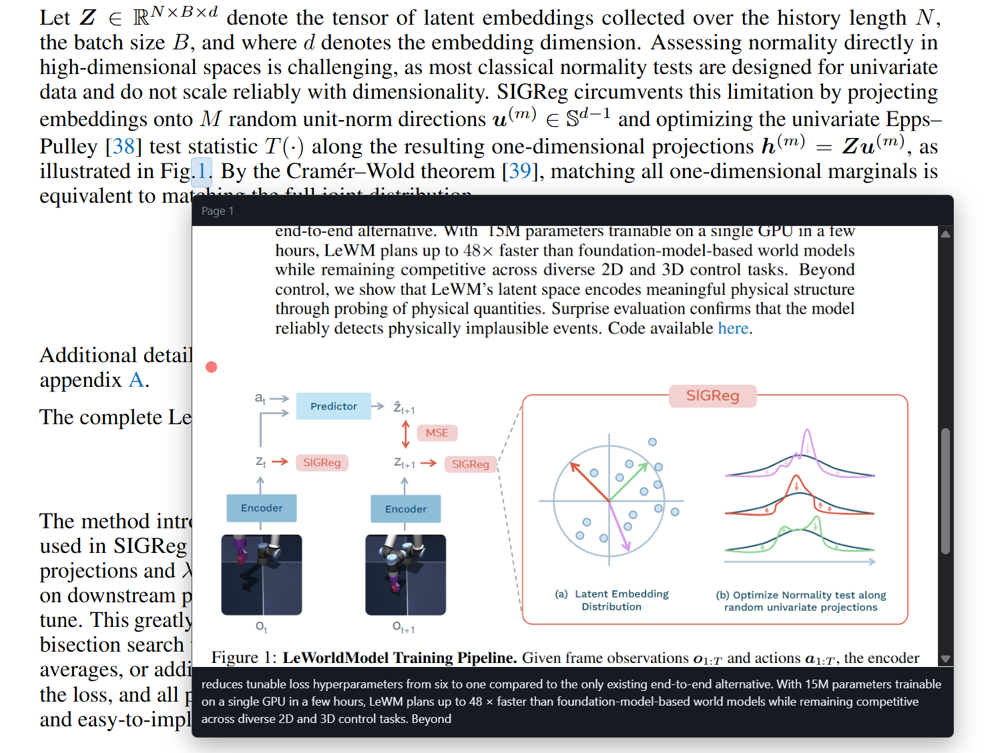
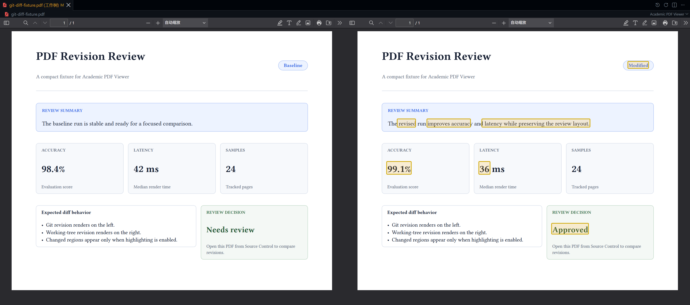

<p align="center">
  <a href="https://github.com/VeriTas-arch/academic-pdf-viewer"></a>
</p>

<h1 align="center">Academic PDF Viewer</h1>

<p align="center">
  <em>Read papers, inspect references, and review PDF revisions inside VS Code.</em>
</p>

<p align="center">
  <a href="https://github.com/VeriTas-arch/academic-pdf-viewer/releases/latest"></a>
  
  <a href="./LICENSE"></a>
</p>

<p align="center">
  <a href="https://marketplace.visualstudio.com/items?itemName=ovolab-veritas.academic-pdf-viewer">VS Code Marketplace</a>
  ·
  <a href="https://github.com/VeriTas-arch/academic-pdf-viewer/releases">GitHub Releases</a>
  ·
  <a href="#install-and-start-reading">Get started</a>
  ·
  <a href="#advanced">Advanced</a>
  ·
  <a href="./CHANGELOG.md">Release notes</a>
</p>

## Install and start reading

On VS Code 1.134 or later, install the stable extension from the [VS Code Marketplace](https://marketplace.visualstudio.com/items?itemName=ovolab-veritas.academic-pdf-viewer). You can also download the [latest stable VSIX](https://github.com/VeriTas-arch/academic-pdf-viewer/releases/latest) and use **Extensions: Install from VSIX...**. The stable release works with standard VS Code settings.

Open a PDF. If another editor opens, choose **Reopen Editor With...** → **Academic PDF Viewer** from the tab context menu.

Use the PDF.js toolbar for search, zoom, outline, page navigation, text selection, printing, and download.

## Preview internal references

Inspect embedded citation, figure, equation, and section links without leaving your reading position.

<p align="center">
  
  <br>
  <sub>Preview a linked destination while keeping the current page in view.</sub>
</p>

1. Hold <kbd>Ctrl</kbd> while hovering over a linked reference.
2. Read the destination preview; move into the popup to scroll it while holding Control.
3. Release Control to close it, or click the original link to navigate normally.

PDFs without internal link annotations remain readable but cannot provide previews. Preview quality depends on the PDF's destinations and text layer.

## Review PDF revisions *(Beta)*

Git PDF comparison is available in the Beta build and requires VS Code's `customEditorDiffs` Proposed API.

1. Download the `*-beta.vsix` asset from a [GitHub pre-release](https://github.com/VeriTas-arch/academic-pdf-viewer/releases) and install it using **Extensions: Install from VSIX...**.
2. Fully quit VS Code, then launch it from an external terminal with the proposal enabled.

   ```powershell
   code --enable-proposed-api ovolab-veritas.academic-pdf-viewer --new-window .
   ```

3. Open a changed or staged PDF from Source Control for side-by-side comparison. Badges distinguish `HEAD`, `Index`, and `Working Tree` when available.

Stable and Beta share the extension ID and version. To switch builds from the command line, use `code --install-extension <path-to-vsix> --force` and restart VS Code. To enable the proposal on every launch, use **Preferences: Configure Runtime Arguments** and add `"enable-proposed-api": ["ovolab-veritas.academic-pdf-viewer"]` to `argv.json`, preserving any existing fields and extension IDs. The Beta is tested on VS Code 1.134.0. Proposed APIs may change in later versions.

<p align="center">
  
  <br>
  <sub>Removed regions on the left; inserted or replaced regions on the right.</sub>
</p>

- Toggle highlights and move between semantic changes using the title-bar controls.
- Scroll positions stay synchronized; zoom remains independent on each side.
- Use `PDF: Reload` after a file or Git revision changes; both sides reload together.

Pages are compared on demand, so navigating across many uncached or complex pages can take longer.

## Shortcuts and commands

| Action | Default shortcut | Availability |
| --- | --- | --- |
| Back / forward | Mouse Back / Forward or <kbd>Alt</kbd>+<kbd>←</kbd> / <kbd>Alt</kbd>+<kbd>→</kbd> | Any viewer tab |
| Zoom around pointer | <kbd>Ctrl</kbd>/<kbd>Cmd</kbd>+<kbd>Wheel</kbd> | Any viewer tab |
| Preview internal link | Hold <kbd>Ctrl</kbd> while hovering | PDFs with internal links |
| Toggle diff highlights | <kbd>Ctrl</kbd>/<kbd>Cmd</kbd>+<kbd>Alt</kbd>+<kbd>D</kbd> | Active PDF diff in Beta |

`PDF: Reload`, `PDF: Toggle Link Preview`, and `PDF Diff: Previous Change` / `PDF Diff: Next Change` are available in the Command Palette when applicable. Assign custom bindings in VS Code's Keyboard Shortcuts editor.

<details>
<summary>Navigation and sidebar preferences</summary>

Under **Academic PDF Viewer › Navigation**, enable Alt shortcuts and mouse side buttons independently, or change the mouse mapping from **Standard** to **Swapped**. `PDF: Navigate Back` and `PDF: Navigate Forward` remain available for custom bindings when the default Alt shortcuts are disabled.

**Navigation: Default Sidebar** selects Pages (default), Outline, Attachments, or Layers when the sidebar opens; it does not open the sidebar automatically. Unavailable views fall back to Pages, and `PDF: Reload` preserves the current view and open or closed state.

</details>

## Advanced

### Settings

Find all options under **Academic PDF Viewer** in VS Code Settings. The names below use the `academicPdfViewer.` prefix.

| Setting | Default | Description |
| --- | --- | --- |
| `linkPreview.enabled` | `true` | Enables Control-hover previews. `PDF: Toggle Link Preview` changes this for the current window. |
| `linkPreview.resolutionScale` | `0` | Automatic screen-density adaptation, with at least 2 image pixels per CSS pixel. `1`–`4` select fixed density without changing popup size. |
| `tex.synctex` | `doubleclick` | Inverse SyncTeX trigger: `off`, `doubleclick`, or `rightclick`. |
| `tex.bridge.enabled` | `false` | Enables the local SyncTeX bridge in trusted workspaces. |

Higher preview densities use more memory and rendering time; large previews remain subject to pixel limits. Existing explicit values from `1` to `4` keep fixed-density behavior; set `0` for automatic adaptation.

<details>
<summary>SyncTeX integration for TeX projects</summary>

For local TeX projects, enable `academicPdfViewer.tex.bridge.enabled` in a trusted workspace. The bridge uses a MiKTeX `synctex.exe`-compatible `view`/`edit` CLI and requires a matching `.synctex` or `.synctex.gz` file.

- From a `.tex` editor, run **TeX: SyncTeX Forward Search** using the title bar, context menu, or Command Palette. No default keybinding is assigned.
- Double-click the PDF for inverse search by default; choose `rightclick` or `off` with `academicPdfViewer.tex.synctex`.
- The target PDF defaults to a sibling file with the same base name. Set `academicPdfViewer.tex.bridge.pdfPath` for a different output location, or `academicPdfViewer.tex.bridge.executable` if the CLI is outside `PATH`.

See the [SyncTeX guide](https://github.com/VeriTas-arch/academic-pdf-viewer/blob/main/docs/synctex.md) for configuration, precision limits, and the complete extension API. ConTeXt `mtxrun`, remote, and virtual-workspace integrations should use that API.

</details>

## Troubleshooting and safety

If PDF diffs stop opening after a VS Code update, check Proposed API access for `ovolab-veritas.academic-pdf-viewer` and fully restart VS Code. PDF JavaScript evaluation remains disabled.

## Project links

- [Release notes](./CHANGELOG.md)
- [Development guide](https://github.com/VeriTas-arch/academic-pdf-viewer/blob/main/docs/development.md): Node.js 24.x setup, tests, manual fixtures, packaging, and PDF.js maintenance.
- [MIT License](./LICENSE)
